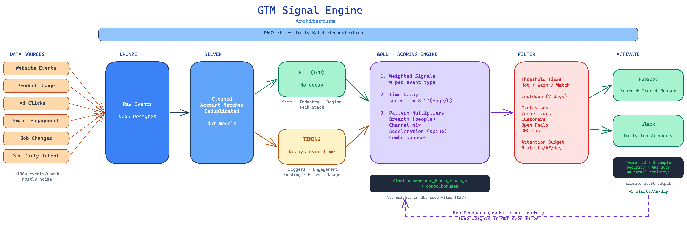

# GTM Signal Engine

A signal prioritization engine for enterprise sales. Replaces noisy single-event alerts with account-level intent scoring — fewer alerts, every one worth acting on.

## Problem

Enterprise revenue teams drown in single-event alerts (page visits, job changes, ad clicks). Reps stop reading them and miss real buyers. The root cause: no decision layer between raw activity and the rep.

## Solution

A scoring engine that judges **patterns, not events**:
- Weights each signal by type and importance
- Decays signals over time (yesterday's pricing visit > last month's)
- Rewards combinations across people and channels (breadth, channel mix, acceleration)
- Alerts only on accounts that cross a threshold
- Attaches a plain-English reason to every alert

## Architecture



📄 **[Full Architecture Spec](docs/architecture.md)** — Functional requirements, data design (ERD + schemas), interface contracts, scoring algorithm, trade-offs, and milestones.

## Stack

| Layer | Tool | Why |
|-------|------|-----|
| Database | Neon Postgres | Free tier, real cloud DB, SQL-native |
| Transforms | dbt-core | Medallion models, weights in seed files |
| Orchestration | Dagster | Asset-based DAG, dbt integration, web UI |
| Data generation | Python + Faker | Synthetic accounts, events, planted buyers |
| Activation | HubSpot sandbox | Score + tier + reason as account properties |
| Notifications | Slack | Daily top-accounts summary |
| CI | GitHub Actions | Lint, test, deploy |

## Scoring Model

Three layers:

1. **Weighted signals** — each event type has a base weight
2. **Time decay** — `score = Σ(weight × 2^(-age / half_life))`
3. **Pattern multipliers** — breadth (multiple people), channel mix, acceleration, combo bonuses

```
final_score = base × m_breadth × m_channels × m_spike + combo_bonuses
```

All weights and multipliers live in dbt seed files — tuning is a config change, not a code change.

## Milestones

| # | Milestone | Output |
|---|-----------|--------|
| 1 | Data + base score | Faker script, bronze/silver/gold tables, decayed scores, naive vs engine alert count |
| 2 | Pattern rules | Breadth, channel mix, combos, spike detection, planted-buyer recall |
| 3 | Suppression + reasons | Threshold, cooldown, exclusions, plain-English alert explanation |
| 4 | Activation | HubSpot push, Dagster scheduled run, Slack summary |
| 5 | Write-up | Architecture docs, trade-offs, results table |

## Project Structure

```
gtm-signal-engine/
├── README.md
├── pyproject.toml
├── datagen/                  # Faker-based synthetic data
│   ├── __init__.py
│   ├── accounts.py           # Company generation
│   ├── people.py             # Contact generation
│   ├── events.py             # Event generation (noise + planted buyers)
│   └── config.py             # Generation parameters
├── dbt_project/              # dbt models
│   ├── dbt_project.yml
│   ├── profiles.yml
│   ├── seeds/                # Signal weights, multipliers, exclusions
│   │   ├── signal_taxonomy.csv
│   │   ├── pattern_multipliers.csv
│   │   └── exclusion_rules.csv
│   └── models/
│       ├── bronze/           # Raw event loading
│       ├── silver/           # Cleaned, account-matched
│       ├── gold/             # Scoring models
│       └── activation/       # Alert generation, suppression
├── orchestration/            # Dagster definitions
│   ├── __init__.py
│   ├── assets.py
│   └── schedules.py
├── activation/               # HubSpot + Slack push
│   ├── __init__.py
│   ├── hubspot.py
│   └── slack.py
└── tests/
    ├── test_datagen.py
    ├── test_scoring.py
    └── test_suppression.py
```

## Setup

```bash
# Create virtual environment
python3 -m venv venv
source venv/bin/activate

# Install dependencies
pip install -e ".[dev]"

# Run data generation
python -m datagen

# Run dbt
cd dbt_project && dbt run

# Launch Dagster UI
dagster dev
```

## Key Design Decisions

- **Batch over streaming.** Enterprise intent builds over days — daily batch loses nothing. Streaming only for hand-raises.
- **Fit vs Timing as separate axes.** Fit (ICP) doesn't decay. Timing does. Prevents noisy bad-fit accounts from outscoring quiet great-fit ones.
- **Attention budget.** Hard daily cap per AE. New alert in → weakest alert out.
- **Weights in config.** All tuning happens in CSV seed files, not code.
