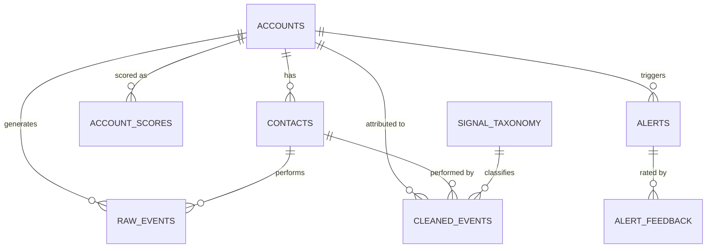

# GTM Signal Engine — Architecture

## 1. Overview

### Problem
Enterprise revenue teams receive single-event alerts (page visits, job changes, ad clicks) at scale — millions of events per month. Most are noise. Reps learn to ignore the entire feed, missing the real buying signals buried in it.

**Root cause**: No decision layer between raw activity and the rep. Every "interesting" event gets pushed; nothing is scored, combined, or filtered.

### Solution
A batch scoring engine that replaces single-event alerts with account-level intent scores. It weights signals, decays them over time, rewards patterns across people and channels, and alerts only on accounts that cross a threshold — with a plain-English reason attached.

### Scope
This document covers the data pipeline from raw event ingestion through scored alerts delivered to sales tools. It does **not** cover:
- The CRM or marketing automation platform itself
- Real-time streaming (explicitly deferred — see Trade-offs)
- Outreach sequencing or email automation

---

## 2. Functional Requirements

### FR-1: Event Ingestion
- Ingest events from 6 source types: website, product, ads, email, job changes/enrichment, third-party intent
- Each event carries: type, source, timestamp, contact identifier (email or IP), and optional properties
- Support both batch file loads and direct database inserts

### FR-2: Identity Resolution
- Match each event to an account by email domain or IP-to-company mapping
- Match each event to a contact (person) where possible
- Exclude internal traffic, competitors, partners, and known bots
- Flag unresolved events for manual review

### FR-3: Signal Scoring
- Assign a base weight to each event type (configurable via seed file)
- Apply time decay: older signals lose value with a configurable half-life per type
- Separate scoring into two independent axes:
  - **Fit** (ICP match): does not decay, acts as a gate/multiplier
  - **Timing** (triggers + engagement): decays over time

### FR-4: Pattern Detection
- **Breadth**: Count distinct people from the same account active in a rolling window
- **Channel mix**: Count distinct event sources (website, product, ads, etc.)
- **Acceleration (spike)**: Compare recent activity to the account's own 8-week baseline
- **Combo bonuses**: Named signal pairs that indicate intent (e.g., docs + security page within 14 days)

### FR-5: Alert Generation
- Apply a score threshold to determine tier: Hot / Warm / Watch
- Enforce a hard daily cap per AE (attention budget)
- If new alert needs a slot, weakest alert drops out
- Every alert carries:
  - Final score
  - Tier
  - One-line plain-English explanation ("why now")
  - Suggested next step

### FR-6: Alert Suppression
- **Cooldown**: Once an account alerts, suppress for N days (configurable) unless score jumps sharply
- **Exclusions**: Skip accounts with open deals, existing customers, competitors, partners, DNC list
- **Deduplication**: No duplicate alerts for the same account within the cooldown window

### FR-7: Activation
- Push account scores, tiers, and explanations to HubSpot as account properties
- Send daily Slack summary of top accounts per AE
- Support manual trigger for ad-hoc scoring runs

### FR-8: Feedback Loop
- Reps mark each alert as useful or not useful
- Track outcomes: meeting booked, opportunity created, no action
- Aggregate feedback to identify signals/weights that need tuning
- Maintain a changelog of weight adjustments

### FR-9: Reporting
- Alert volume per AE per day/week
- Share of alerts acted on (precision)
- Meetings and opportunities sourced from alerts
- Time from signal to first outreach
- Rep usefulness rating

---

## 3. Non-Functional Requirements

| Requirement | Target | Rationale |
|-------------|--------|-----------|
| **Data freshness** | Scores refreshed daily by 7am local | AEs check alerts at start of day |
| **Pipeline runtime** | < 30 minutes for full run | Must complete within nightly batch window |
| **Data volume** | 500 accounts, 5k contacts, 100k events (synthetic); scales to 50k accounts, 1M events in production | Design for 10x growth |
| **Availability** | 99% uptime for pipeline (daily batch, not real-time) | Missed day is recoverable; missed week is not |
| **Idempotency** | Pipeline re-runs produce identical results | Safe to retry on failure |
| **Observability** | Dagster UI shows run status, dbt logs, row counts per model | Ops team can diagnose failures without reading code |
| **Configurability** | All weights, thresholds, multipliers in CSV seed files | Tuning is a config change, not a code change |
| **Auditability** | Score history retained for 90 days | Explain why an account was/wasn't alerted on any given day |
| **Security** | No PII in logs; database credentials in env vars only | GDPR compliance; secret management |
| **Testability** | Planted buyers in synthetic data with known outcomes | Validate scoring logic against ground truth |

---

## 4. Data Design

### 4.1 Entity-Relationship Diagram



### 4.2 Table Schemas

#### `bronze.raw_events`
Raw events as received from sources. No transformation, no deduplication.

| Column | Type | Nullable | Description |
|--------|------|----------|-------------|
| event_id | UUID | PK | Unique event identifier |
| event_type | VARCHAR(50) | No | Signal type (from taxonomy) |
| event_source | VARCHAR(20) | No | Source channel: website, product, ads, email, enrichment, third_party |
| contact_email | VARCHAR(255) | Yes | Email of the person (if known) |
| email_domain | VARCHAR(100) | Yes | Extracted domain for account matching |
| ip_address | VARCHAR(45) | Yes | For IP-to-company resolution |
| event_properties | JSONB | Yes | Source-specific metadata |
| occurred_at | TIMESTAMP | No | When the event happened |
| ingested_at | TIMESTAMP | No | When we received it |

#### `bronze.accounts`
Account (company) master data.

| Column | Type | Nullable | Description |
|--------|------|----------|-------------|
| account_id | UUID | PK | |
| company_name | VARCHAR(200) | No | |
| domain | VARCHAR(100) | No | Primary email domain |
| industry | VARCHAR(100) | Yes | |
| employee_count | INTEGER | Yes | |
| region | VARCHAR(50) | Yes | |
| tech_stack | TEXT[] | Yes | Known tools in use |
| customer_status | VARCHAR(20) | No | prospect / customer / churned |
| account_tags | TEXT[] | Yes | competitor, partner, etc. |
| deal_stage | VARCHAR(50) | Yes | Current deal stage (null = no deal) |
| assigned_ae_id | VARCHAR(50) | Yes | AE responsible for this account |
| created_at | TIMESTAMP | No | |

#### `bronze.contacts`
People associated with accounts.

| Column | Type | Nullable | Description |
|--------|------|----------|-------------|
| contact_id | UUID | PK | |
| account_id | UUID | FK → accounts | |
| email | VARCHAR(255) | No | |
| first_name | VARCHAR(100) | Yes | |
| last_name | VARCHAR(100) | Yes | |
| title | VARCHAR(200) | Yes | Job title |
| seniority_level | VARCHAR(20) | Yes | executive / manager / ic |
| department | VARCHAR(50) | Yes | |
| contact_status | VARCHAR(20) | No | active / dnc / bounced |
| created_at | TIMESTAMP | No | |

#### `silver.cleaned_events`
Events matched to accounts and contacts, exclusions removed.

| Column | Type | Nullable | Description |
|--------|------|----------|-------------|
| event_id | UUID | PK | From raw_events |
| event_type | VARCHAR(50) | No | |
| signal_category | VARCHAR(20) | No | fit / trigger / engagement |
| event_source | VARCHAR(20) | No | |
| contact_id | UUID | FK → contacts | Resolved contact |
| account_id | UUID | FK → accounts | Resolved account |
| base_weight | NUMERIC(5,2) | No | From signal_taxonomy seed |
| half_life_days | INTEGER | No | From signal_taxonomy seed |
| occurred_at | TIMESTAMP | No | |

#### `gold.account_scores`
Daily computed scores per account.

| Column | Type | Nullable | Description |
|--------|------|----------|-------------|
| account_id | UUID | PK | |
| score_date | DATE | PK | |
| base_score | NUMERIC(10,2) | No | Sum of decayed weighted signals |
| fit_score | NUMERIC(5,2) | No | ICP match score (does not decay) |
| timing_score | NUMERIC(10,2) | No | Trigger + engagement score (decayed) |
| distinct_people | INTEGER | No | Unique contacts active in window |
| distinct_channels | INTEGER | No | Unique event sources in window |
| activity_ratio | NUMERIC(5,2) | No | Last 7d vs 8-week avg |
| breadth_multiplier | NUMERIC(4,2) | No | From pattern_multipliers seed |
| channel_mix_multiplier | NUMERIC(4,2) | No | |
| spike_multiplier | NUMERIC(4,2) | No | |
| combo_bonus | NUMERIC(6,2) | No | Sum of matched combo rules |
| final_score | NUMERIC(10,2) | No | base × multipliers + combos |
| tier | VARCHAR(10) | No | hot / warm / watch / none |
| explanation | TEXT | No | Plain-English "why now" |
| computed_at | TIMESTAMP | No | |

#### `gold.alerts`
Alerts generated after filtering and suppression.

| Column | Type | Nullable | Description |
|--------|------|----------|-------------|
| alert_id | UUID | PK | |
| account_id | UUID | FK → accounts | |
| ae_id | VARCHAR(50) | No | Assigned AE |
| alert_date | DATE | No | |
| final_score | NUMERIC(10,2) | No | Score at alert time |
| tier | VARCHAR(10) | No | hot / warm / watch |
| explanation | TEXT | No | "why now" reason |
| suggested_action | TEXT | Yes | Recommended next step |
| suppressed | BOOLEAN | No | Was this alert suppressed? |
| suppression_reason | VARCHAR(50) | Yes | cooldown / exclusion / budget |
| created_at | TIMESTAMP | No | |

#### `gold.alert_feedback`
Rep ratings on alert quality.

| Column | Type | Nullable | Description |
|--------|------|----------|-------------|
| feedback_id | UUID | PK | |
| alert_id | UUID | FK → alerts | |
| ae_id | VARCHAR(50) | No | |
| rating | VARCHAR(20) | No | useful / not_useful |
| outcome | VARCHAR(30) | Yes | meeting / opportunity / no_action |
| notes | TEXT | Yes | Free-text rep comment |
| created_at | TIMESTAMP | No | |

### 4.3 Seed Tables (Configuration)

These live as CSV files in `dbt_project/seeds/` and are loaded by `dbt seed`. They are the tuning interface — no code changes needed to adjust weights.

| Seed File | Purpose | Key Columns |
|-----------|---------|-------------|
| `signal_taxonomy.csv` | Base weight and half-life per signal type | signal_type, base_weight, half_life_days |
| `pattern_multipliers.csv` | Multiplier values for breadth, channel mix, spike | multiplier_name, condition, value |
| `combo_bonuses.csv` | Named signal pairs and their bonus points | signal_a, signal_b, window_days, bonus_points |
| `exclusion_rules.csv` | Accounts to skip | rule_name, field, condition |
| `suppression_config.csv` | Cooldown, daily cap, tier thresholds | parameter, value |

### 4.4 Schema Separation

| Schema | Layer | Purpose |
|--------|-------|---------|
| `bronze` | Raw | Untransformed source data |
| `silver` | Cleaned | Account-matched, deduplicated, enriched with taxonomy |
| `gold` | Scored | Computed scores, alerts, feedback |
| `seeds` | Config | dbt seed tables (signal weights, multipliers, rules) |

---

## 5. Interface Design

### 5.1 Data Contracts Between Layers

#### Bronze → Silver Contract
Silver models expect each `raw_event` to have:
- A non-null `event_type` that exists in `signal_taxonomy`
- At least one of: `contact_email`, `email_domain`, or `ip_address`
- A valid `occurred_at` timestamp

Events that fail validation are logged to `silver.unresolved_events` for review.

#### Silver → Gold Contract
Gold models expect each `cleaned_event` to have:
- A resolved `account_id` (non-null)
- A valid `base_weight` and `half_life_days` from the taxonomy join
- `signal_category` in ('fit', 'trigger', 'engagement')

#### Gold → Activation Contract
Activation reads from `gold.alerts` where `suppressed = false`, ordered by `final_score DESC`, limited to `max_alerts_per_ae_per_day` from `suppression_config`.

### 5.2 HubSpot Payload

Pushed via reverse ETL (or API) as account-level custom properties:

```json
{
  "account_id": "hubspot_company_id",
  "properties": {
    "signal_score": 82,
    "signal_tier": "hot",
    "signal_explanation": "3 people · security page + API docs + pricing · 4× normal activity",
    "signal_last_scored": "2026-10-24",
    "signal_distinct_people": 3,
    "signal_top_signal": "security_page"
  }
}
```

### 5.3 Slack Message Format

Daily digest per AE, posted to a designated channel:

```
🔥 Your Top Accounts Today

1. Acme Corp — 82 (Hot)
   3 people · security + API docs · 4× spike
   → Multi-thread: VP Eng, Security Lead, DevOps Mgr

2. Globex Inc — 71 (Hot)
   2 people · pricing + trial · new VP Engineering
   → Reference recent funding round in outreach

3. Initech — 48 (Warm)
   1 person · integration docs + product trial
   → Follow up on trial activity

📊 5 alerts today (3 hot, 2 warm) | Yesterday: 2 of 4 acted on
```

### 5.4 Dagster Asset Interface

Each pipeline stage is a Dagster asset with declared dependencies:

```
raw_events (source)
  → cleaned_events (depends on: raw_events, signal_taxonomy)
    → account_base_scores (depends on: cleaned_events)
      → account_pattern_scores (depends on: account_base_scores, pattern_multipliers, combo_bonuses)
        → account_final_scores (depends on: account_pattern_scores, suppression_config, exclusion_rules)
          → alerts (depends on: account_final_scores)
            → hubspot_push (depends on: alerts)
            → slack_summary (depends on: alerts)
```

---

## 6. High-Level Design (HLD)

### 6.1 System Architecture


### 6.2 Component Responsibilities

| Component | Responsibility | Input | Output |
|-----------|---------------|-------|--------|
| **Data Generator** (Faker) | Create synthetic accounts, contacts, events with planted buyers | Config parameters | Bronze tables populated |
| **Bronze Layer** | Store raw events without transformation | Source data (CSV, API, webhook) | `bronze.raw_events`, `bronze.accounts`, `bronze.contacts` |
| **Silver Layer** (dbt) | Match events to accounts/contacts, join taxonomy, exclude noise | Bronze tables + seed tables | `silver.cleaned_events` |
| **Gold Layer** (dbt) | Score accounts: decay, multiply, combine, threshold, explain | Silver tables + seed tables | `gold.account_scores`, `gold.alerts` |
| **Filter/Suppress** (dbt) | Apply cooldown, exclusions, attention budget | Gold scores + config seeds | Filtered `gold.alerts` |
| **HubSpot Push** (Python) | Write scores to CRM | `gold.alerts` | HubSpot company properties updated |
| **Slack Push** (Python) | Send daily digest | `gold.alerts` | Slack messages delivered |
| **Dagster** | Orchestrate daily batch, manage dependencies, provide observability | Schedule trigger | All of the above executed in order |

### 6.3 Data Flow

```
                    ┌──────────────────────────────────────────────────┐
                    │              DAGSTER (daily batch)                │
                    └──────────────────────────────────────────────────┘
                           │          │          │          │
                    ┌──────▼──┐ ┌─────▼────┐ ┌──▼──────┐ ┌▼─────────┐
  Sources ──────►   │ BRONZE   │►│ SILVER    │►│ GOLD    │►│ ACTIVATE  │
  (6 types)         │ raw store│ │ clean +   │ │ score + │ │ HubSpot + │
                    │          │ │ match     │ │ filter  │ │ Slack     │
                    └──────────┘ └──────────┘ └────┬────┘ └─────┬─────┘
                                                    │            │
                                                    │    ┌───────▼──────┐
                                                    │◄───│ REP FEEDBACK  │
                                                    │    │ useful / not  │
                                              ┌─────▼──┐ └──────────────┘
                                              │ SEEDS   │
                                              │ (tune)  │
                                              └────────┘
```

---

## 7. Low-Level Design (LLD)

### 7.1 Scoring Algorithm (Step-by-Step)

**Input**: All `silver.cleaned_events` for a given `score_date`

**Step 1 — Base Score (per account)**
```
For each event e belonging to account A:
    age_days = score_date - e.occurred_at
    decayed_weight = e.base_weight × 2^(-age_days / e.half_life_days)

base_score(A) = SUM(decayed_weight) for all events of A
```

**Step 2 — Fit Score (per account)**
```
fit_score(A) = count of matching ICP criteria:
    +1 if employee_count in target range
    +1 if industry in target list
    +1 if region in target list
    +1 if tech_stack overlaps with compatible tools

Fit does NOT decay. It changes only when account data changes.
```

**Step 3 — Pattern Multipliers (per account, rolling 14-day window)**
```
distinct_people = COUNT(DISTINCT contact_id) from events in last 14 days
distinct_channels = COUNT(DISTINCT event_source) from events in last 14 days
activity_ratio = events_last_7d / avg_events_per_week_last_8_weeks

breadth_multiplier = lookup(pattern_multipliers, distinct_people)
channel_mix_multiplier = lookup(pattern_multipliers, distinct_channels)
spike_multiplier = lookup(pattern_multipliers, activity_ratio)
```

**Step 4 — Combo Bonuses (per account)**
```
For each rule in combo_bonuses:
    if account has signal_a AND signal_b within window_days of each other:
        combo_bonus += rule.bonus_points
```

**Step 5 — Final Score**
```
timing_score = base_score × breadth_multiplier × channel_mix_multiplier × spike_multiplier + combo_bonus
final_score = timing_score × fit_gate(fit_score)

where fit_gate:
    fit_score >= 3 → 1.0 (full pass)
    fit_score == 2 → 0.7 (partial)
    fit_score <= 1 → 0.3 (low fit penalty)
```

**Step 6 — Tier Assignment**
```
if final_score >= hot_threshold   → "hot"
if final_score >= warm_threshold  → "warm"
if final_score >= watch_threshold → "watch"
else                              → "none"
```

**Step 7 — Explanation Generation**
```
explanation = "{company}: {score} · {people} people · {top_signals} · {spike_text}"

Example: "Acme: 82 · 3 people · security page + API docs + pricing · 4× normal activity"
```

### 7.2 Suppression Logic

Applied after scoring, before alert delivery:

```sql
-- Pseudocode for suppression
WITH scored AS (
    SELECT * FROM gold.account_scores WHERE tier != 'none'
),
after_cooldown AS (
    SELECT s.*
    FROM scored s
    LEFT JOIN gold.alerts prev
        ON s.account_id = prev.account_id
        AND prev.alert_date > CURRENT_DATE - cooldown_days
        AND prev.suppressed = false
    WHERE prev.alert_id IS NULL
       OR s.final_score > prev.final_score * cooldown_override_jump
),
after_exclusions AS (
    SELECT a.*
    FROM after_cooldown a
    JOIN bronze.accounts acc ON a.account_id = acc.account_id
    WHERE acc.customer_status != 'customer'
      AND NOT ('competitor' = ANY(acc.account_tags))
      AND NOT ('partner' = ANY(acc.account_tags))
      AND acc.deal_stage IS NULL
),
with_budget AS (
    SELECT *,
        ROW_NUMBER() OVER (
            PARTITION BY ae_id
            ORDER BY final_score DESC
        ) AS rank_for_ae
    FROM after_exclusions
)
SELECT * FROM with_budget
WHERE rank_for_ae <= max_alerts_per_ae_per_day
```

### 7.3 dbt Model Dependency Graph

```
seeds/
├── signal_taxonomy          (base weights, half-lives)
├── pattern_multipliers      (breadth, channel, spike rules)
├── combo_bonuses            (signal pair bonuses)
├── exclusion_rules          (skip criteria)
└── suppression_config       (cooldown, budget, thresholds)

models/
├── bronze/
│   ├── stg_raw_events       (source: bronze.raw_events)
│   ├── stg_accounts         (source: bronze.accounts)
│   └── stg_contacts         (source: bronze.contacts)
│
├── silver/
│   ├── int_event_account_match   (join events → accounts via domain/IP)
│   ├── int_event_contact_match   (join events → contacts via email)
│   ├── int_event_exclusions      (flag internal/competitor/bot traffic)
│   └── cleaned_events            (final silver: matched + enriched + filtered)
│
├── gold/
│   ├── int_base_scores           (decayed weighted sum per account)
│   ├── int_fit_scores            (ICP match per account)
│   ├── int_pattern_metrics       (breadth, channels, spike per account)
│   ├── int_combo_matches         (signal pair detection per account)
│   ├── account_scores            (final score = base × multipliers + combos)
│   └── score_explanations        (plain-English "why now" per account)
│
└── activation/
    ├── int_suppression           (cooldown + exclusions applied)
    ├── int_attention_budget      (rank + cap per AE)
    └── alerts                    (final alerts: unsuppressed, within budget)
```

### 7.4 Dagster Asset Definitions

```python
# Conceptual — not runnable code

@asset
def raw_events(context) -> pd.DataFrame:
    """Load raw events from bronze schema."""

@asset(deps=[raw_events])
def cleaned_events(context, raw_events) -> pd.DataFrame:
    """Run dbt silver models: match, enrich, filter."""

@asset(deps=[cleaned_events])
def account_scores(context, cleaned_events) -> pd.DataFrame:
    """Run dbt gold models: decay, multiply, combine."""

@asset(deps=[account_scores])
def alerts(context, account_scores) -> pd.DataFrame:
    """Run dbt activation models: suppress, budget, explain."""

@asset(deps=[alerts])
def hubspot_push(context, alerts):
    """Push scores and tiers to HubSpot via API."""

@asset(deps=[alerts])
def slack_summary(context, alerts):
    """Post daily digest to Slack."""

@schedule(cron_schedule="0 6 * * *", target=[hubspot_push, slack_summary])
def daily_scoring_schedule():
    """Run full pipeline at 6am daily."""
```

### 7.5 Data Generation (Faker)

The synthetic dataset plants known patterns to validate scoring:

| Entity | Count | Notes |
|--------|-------|-------|
| Accounts | ~500 | Mix of ICP-fit and non-fit |
| Contacts | ~5,000 | 5-15 per account, varied seniority |
| Events | ~100,000 | 90% noise, 10% planted buyer patterns |
| Planted buyers | ~10 | Accounts with multi-person, multi-channel, high-intent patterns |

**Planted buyer pattern**: 3+ people from the same account, visiting security + pricing + docs within 14 days, with a spike ratio of 4×+. These must score highest when the engine runs.

**Noise patterns**: Single random page visits, bot-like bursts (many events in 1 minute from 1 person), isolated job changes, competitor/internal traffic.

---

## 8. Trade-offs & Decisions

### TD-1: Batch vs Streaming
**Decision**: Daily batch pipeline.
**Why**: Enterprise buying intent builds over days and weeks. A score refreshed daily loses almost nothing versus real-time. Streaming adds Kafka/Pub-Sub infrastructure, operational complexity, and cost — none of which is justified by the use case.
**Exception**: Hand-raises (demo requests, trial sign-ups from named targets) bypass scoring and route directly. This is a webhook, not a streaming pipeline.

### TD-2: Neon Postgres vs Databricks
**Decision**: Neon Postgres.
**Why**: Free tier is sufficient for synthetic data (500 accounts, 100k events). SQL-native, real cloud database, dbt-compatible. Databricks adds cost and a Spark dependency that this data volume doesn't need. If a client runs this at scale (50k+ accounts, 10M+ events), porting dbt models to Databricks is a config change.

### TD-3: Fit and Timing as Separate Axes
**Decision**: Two independent scores, not one blended number.
**Why**: A very active but bad-fit account (e.g., competitor researching your product) should not outscore a great-fit account that just raised money. Fit acts as a gate/multiplier on the decayed timing score.

### TD-4: Weights in Config, Not Code
**Decision**: All signal weights, multipliers, thresholds, and suppression rules live in dbt seed CSV files.
**Why**: The scoring model will be tuned frequently based on rep feedback. Tuning should be a CSV edit + `dbt seed`, not a code change + deploy. This also makes the model auditable — the changelog is git history on CSV files.

### TD-5: Dagster vs GitHub Actions
**Decision**: Dagster for orchestration.
**Why**: GitHub Actions can trigger daily runs, but provides no visibility into the pipeline. Dagster treats each dbt model as an asset in a dependency graph, gives a web UI for run history and debugging, and supports sensors for reactive triggers. The open-source tier runs locally at no cost.

### TD-6: Attention Budget (Hard Cap)
**Decision**: Hard daily limit per AE, not just a threshold.
**Why**: A threshold alone doesn't control volume — if 20 accounts cross the threshold, the AE still gets 20 alerts. The budget forces prioritization: top N by score, rest dropped to Warm/Watch visibility without a ping. This is the mechanism that makes reps trust the system.

### TD-7: Explanation-First Alerts
**Decision**: Every alert must carry a plain-English reason.
**Why**: A bare score (e.g., "82") doesn't drive action. An explanation ("3 people, security + docs + pricing, 4× spike") tells the rep what happened and what to say. If the system can't explain why it fired, it shouldn't fire.

---

## 9. Milestones

Each milestone is independently shippable and testable.

| # | Milestone | Deliverables | Success Criteria |
|---|-----------|-------------|-----------------|
| 1 | **Data + Base Score** | Faker script, bronze/silver/gold tables, one dbt model computing decayed scores | Naive (1-per-event) vs engine alert count comparison |
| 2 | **Pattern Rules** | Breadth, channel mix, spike, combo detection models | All 10 planted buyers in top 20 scored accounts |
| 3 | **Suppression + Reasons** | Threshold, cooldown, exclusions, attention budget, explanation generation | Alert volume ≤ 5/AE/day; every alert has explanation |
| 4 | **Activation** | HubSpot push, Dagster scheduled run, Slack daily digest | End-to-end pipeline runs daily, scores appear in CRM |
| 5 | **Write-up** | README, architecture docs, results table, trade-off rationale | Portfolio-ready with clear before/after metrics |
