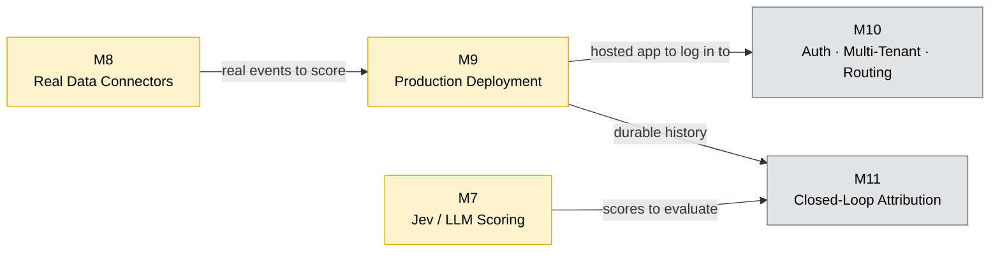
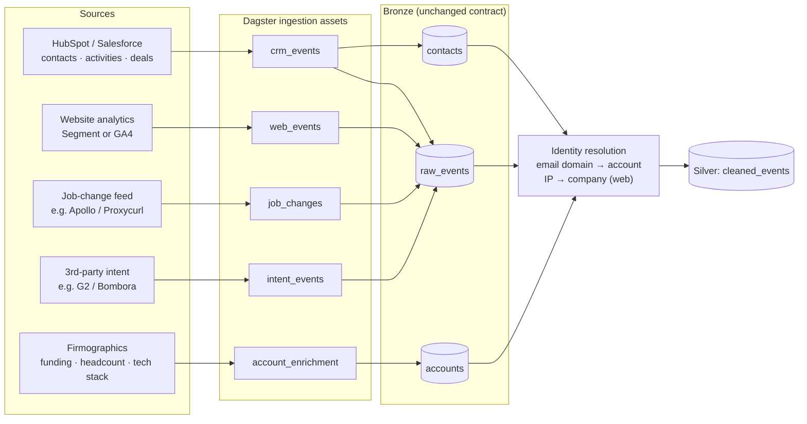
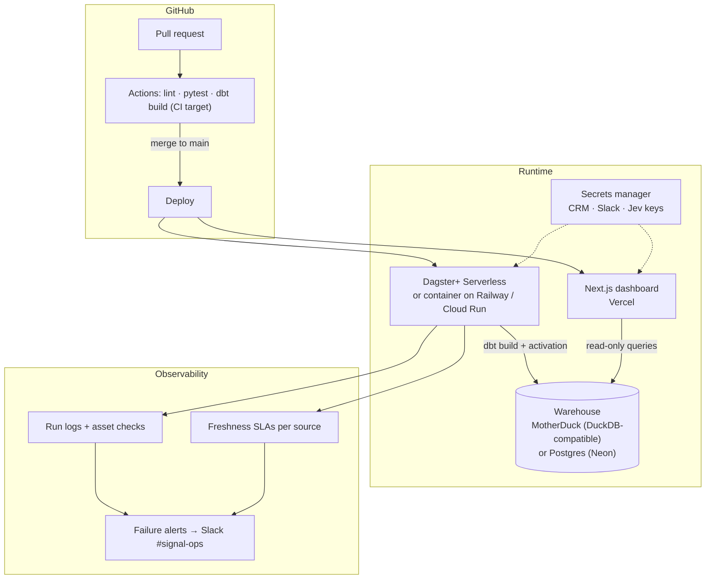
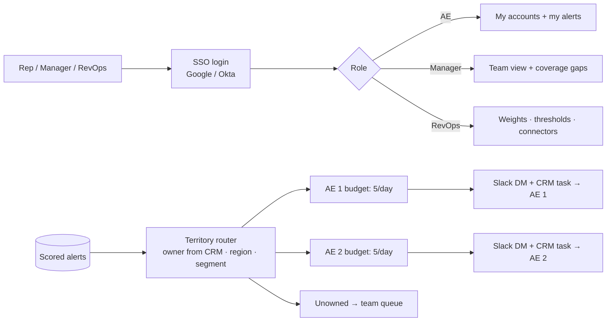
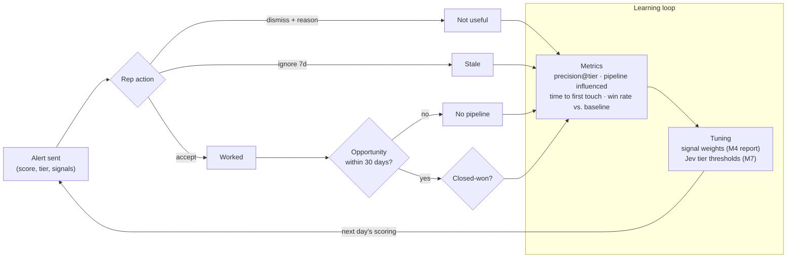

# Roadmap — v2 Enterprise

v1 (M1–M6) proves the scoring approach end to end on synthetic data, running locally. v2 makes it something a real revenue team could run every day: live data, model judgment, hosted infrastructure, per-team access, and proof that alerts turn into pipeline.

| Milestone | Why it matters | Depends on | Status |
|-----------|---------------|-----------|--------|
| [M7 — Jev / LLM Scoring](m7-llm-scoring-spec.md) | Scores reasoned from context, not just fixed weights | — | Proposed |
| [M8 — Real Data Connectors](#m8--real-data-connectors) | Without real data it's a demo | — | Proposed |
| [M9 — Production Deployment](#m9--production-deployment) | Runs without a laptop, has alerting, keeps history | M8 | Proposed |
| [M10 — Auth, Multi-Tenant & Routing](#m10--auth-multi-tenant--alert-routing) | Each AE sees only their accounts | M9 | Later |
| [M11 — Closed-Loop Attribution](#m11--closed-loop-attribution) | Proves which alerts became pipeline | M7, M9 | Later |

M7 and M8 can run in parallel. M7 can be validated on synthetic data, including recall of the 10 planted buyers.

---

## M8 — Real Data Connectors

**Goal:** replace `datagen` with live sources while keeping bronze → silver → gold unchanged.

### Scope
- One Dagster asset per source, with incremental loads (cursor or `updated_since`) and idempotent upserts.
- A shared bronze contract: every connector emits `event_id, account_domain, contact_email, signal_type, occurred_at, source`.
- New `signal_taxonomy` rows for new signal types. Weights stay in the seed CSV.
- Identity resolution in silver: email domain → account, with a reverse-IP lookup for anonymous web traffic.
- PII handling: hash or drop personal fields that scoring doesn't need.
- Keep `datagen` as a `--source synthetic` option for demos and tests.

### Build order
1. **HubSpot** (credentials already exist): contacts, engagements, form fills and deals. Deals also feed the `open_deal` exclusion rule.
2. **Website analytics** (Segment or GA4): page views mapped to `pricing_page`, `security_page`, `docs_page`, and so on.
3. **Job changes and firmographics**: the trigger signals (`new_vp_hire`, `funding_round`, `relevant_job_posts`).
4. **Third-party intent** (optional; it costs money).

### Acceptance criteria
- [ ] The pipeline runs end to end on HubSpot data, with no Faker data in the run.
- [ ] Re-running a connector produces no duplicate events.
- [ ] More than 90% of CRM events and more than 40% of web events are matched to an account.
- [ ] All 35 existing dbt tests pass, plus freshness tests per source.

---

## M9 — Production Deployment

**Goal:** the pipeline runs on schedule without a laptop, the dashboard has a URL, failures page someone, and history is kept.

### Scope
- **Warehouse.** MotherDuck is the smallest change (it speaks DuckDB SQL, so the dbt models and adapter stay the same). Postgres on Neon is the more general option. Either one replaces the local `.duckdb` file.
- **Dashboard data access.** Replace the Python-subprocess query path with a direct warehouse client, which the warehouse makes possible.
- **Orchestration.** Dagster+ Serverless, or `dagster-webserver` and the daemon in one container. Keep the daily 06:00 UTC schedule.
- **Secrets.** Move them out of `.env` into Dagster+ or Vercel environment secrets. Rotate the keys used during development.
- **CI/CD.** Extend the existing GitHub Actions: run `dbt build` against a CI target, deploy on merge, and create Vercel preview deploys per PR.
- **Observability.** Dagster asset checks, a freshness SLA per source, run-failure alerts to a Slack ops channel, and an activation summary metric (alerts sent and failed per channel).
- **Reliability.** Make activation idempotent with a dedupe key per account per day, so re-runs don't double-post. Add retries with backoff on CRM and Slack calls.
- **Containerization.** Add a `Dockerfile` for the pipeline so the same image runs locally and in production.

### Acceptance criteria
- [ ] The scheduled run succeeds for 7 consecutive days with no manual steps.
- [ ] A deliberate failure (for example, a bad credential) triggers a Slack ops alert within 5 minutes.
- [ ] Re-running a day posts no duplicate Slack messages or CRM tasks.
- [ ] The dashboard is reachable at a URL and loads in under 2 seconds.
- [ ] No secrets in the repo or images (CI secret scan passes).

---

## M10 — Auth, Multi-Tenant & Alert Routing

**Goal:** many reps and teams use one deployment, and each person sees and receives only what's theirs.

### Scope
- SSO for the dashboard (Clerk, Auth.js or WorkOS) with three roles: AE, Manager, RevOps admin.
- Tenant and team isolation in the data model (a `team_id` on accounts, alerts and config). Row-level filtering on every query.
- Routing: account owner synced from the CRM, with territory rules as fallback. The attention budget (currently `max_alerts_per_ae_per_day = 5`) is enforced per AE, not globally.
- Delivery per person: Slack DMs, plus CRM tasks assigned to the owner rather than unassigned.
- An admin UI for weights and thresholds, writing a versioned config instead of hand-edited CSVs. Every change is audit-logged.

### Acceptance criteria
- [ ] An AE can't see another AE's accounts through the UI or the API.
- [ ] Each AE gets at most their budget of alerts per day.
- [ ] A weight change in the admin UI shows in the next run and appears in the audit log.

---

## M11 — Closed-Loop Attribution

**Goal:** show which alerts led to pipeline, and use the outcomes to improve scoring automatically.

### Scope
- Sync opportunities and stages from the CRM (this builds on the M8 HubSpot connector) and link them to alerts by account within an attribution window.
- An outcome model: `alert → action → opportunity → stage → won/lost`, stored as history and never overwritten.
- A metrics page: precision by tier, pipeline influenced (in dollars), median time to first touch, and win rate on alerted vs. non-alerted accounts.
- Tuning: extend the M4 tuning report to use opportunity outcomes as well as accept/dismiss. Recalibrate the M7 Jev thresholds against outcomes.
- Few-shot examples: feed recent won and dismissed alerts back as examples in the scoring context (M7, Phase D).

### Acceptance criteria
- [ ] Every alert has a traceable outcome after 30 days.
- [ ] The metrics page shows pipeline influenced, broken down by tier and by signal type.
- [ ] A weekly tuning report proposes weight and threshold changes, with the expected change in precision.

---

## Cross-Cutting (every milestone)

| Area | Standard |
|------|----------|
| Testing | Unit + integration tests per module; dbt tests per model; 80%+ coverage on new Python |
| Security | No secrets in code; PII minimization; least-privilege API scopes |
| Config over code | New weights, thresholds and questions go in versioned config |
| Dry-run | Every external write supports dry-run |
| Docs | Each milestone updates the README's flow diagrams and Quick Start |
